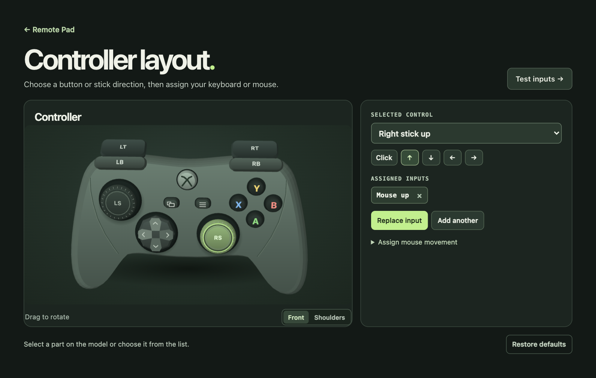

# Remote Pad

Play games installed on your Xbox with your Mac’s keyboard and mouse. Remote Pad gives the Xbox Remote Play web player a virtual Xbox-style controller. Use WASD to move, move the mouse to look, and click to use the triggers. The controller works inside the player, and capture ends when you press Esc or switch windows.

**[Download Remote Pad for macOS](https://github.com/lamacchiasolutions/remote-pad/releases/latest/download/Remote-Pad-macOS.zip)** · [Release notes](https://github.com/lamacchiasolutions/remote-pad/releases/latest)

Lamacchia Solutions permits free noncommercial use and source inspection. Redistribution and commercial reuse require written permission. Review the end-user agreement before downloading. A copy is included under **Help → End-User License Agreement** in the app. [End-user license agreement](EULA.md) · [License](LICENSE)

## Install

1. Download **Remote-Pad-macOS.zip**. The same download runs on Apple silicon and Intel Macs with **macOS 13 or later**.
2. Double-click the ZIP in Finder. Drag **Remote Pad.app** to **Applications**, then open it.
3. This release uses an ad hoc signature and has no Apple notarization. If macOS blocks the first launch and you trust this download, open **System Settings → Privacy & Security**, find Remote Pad, choose **Open Anyway**, and confirm. Managed Macs may require administrator assistance. [Apple’s instructions for opening downloaded apps](https://support.apple.com/en-us/102445)

## Connect and play

1. On your **Xbox Series X, Series S, or Xbox One**, open **Settings → Devices & connections → Remote features** and enable remote features. You’ll need a game installed on the console, a Microsoft account with an Xbox profile, and an internet connection. [Xbox Remote Play requirements](https://www.xbox.com/en-US/consoles/remote-play)
2. On your Mac, select **Test inputs → Capture inputs**. Move the mouse with both buttons released. The right-stick dot should follow the direction of movement and return to center when you stop. Press **Esc** to get your cursor back.
3. Return to the home screen and select **Open Remote Play**. Sign in on Microsoft’s page with the account linked to your Xbox and select the console. [Xbox Remote Play](https://www.xbox.com/remoteplay)
4. Select **Capture inputs** to play. Press **Esc** to use the cursor again. **F8** toggles capture unless you assign it to a game control. On keyboards that use the top row for media keys, press **Fn–F8**.

## Default controls

| Xbox control | Mac input |
| --- | --- |
| Left stick | W / A / S / D |
| Right stick | Move the mouse |
| RT / LT | Left click / right click |
| A / B / X / Y | Space / C / R / F |
| LB / RB | Q / E |
| Left stick click / right stick click | Left Shift / V |
| D-pad | Arrow keys |
| View / Menu / Xbox guide | Tab / Return / G |

## Customize your layout

Choose **Map controls** on the home screen. Select a part of the controller model or use the list. **Shoulders** shows the bumpers and triggers. For a stick, choose its click or one of its four directions.



Choose **Replace input**, then press a key or click the recording box with the mouse button you want. **Add another** keeps the existing assignment. **Assign mouse movement** binds a direction of mouse travel. If an input is already in use, choose **Move here** or **Use for both**. Changes save automatically. Esc releases capture, and Command shortcuts stay available to macOS.

During play, press **Esc → ⋯ → Map controls** to edit the same layout. The **⋯** menu also contains these settings.

- **Mouse sensitivity** changes how far the virtual stick moves for a given mouse speed. Each game’s controller settings determine its maximum turning speed.
- **Minimum look strength** sets the initial stick deflection. The default is **27%**. Raise it if a game ignores slow mouse movement, or lower it for a game with a smaller stick dead zone.
- **Show stick and triggers during play** displays the input Remote Pad sends. With the default layout, right click lights LT, left click lights RT, and moving the mouse moves the right stick even with both buttons released.

## Use Google Chrome

The Mac app includes an optional extension for playing in desktop Google Chrome.

1. On the app’s home screen, expand **Play in Google Chrome** and select **Set up Chrome**. This opens Chrome’s Extensions page and copies the extension folder’s path.
2. Enable **Developer mode** and choose **Load unpacked**. In the folder picker, press **⌘⇧G**, paste the copied path, press Return, and confirm the folder.
3. Back in Remote Pad, choose **Open in Chrome**. Your saved app layout comes with you. You can edit it inside Chrome. Reopening from the app with the same layout preserves later Chrome edits.

After updating the Mac app, choose **Set up Chrome** again, click the reload arrow on Remote Pad’s extension card, and refresh the Remote Play tab.

## Build and test

Build from the repository root on a Mac with current Xcode Command Line Tools.

```sh
./build.sh
```

The build creates `dist/Remote Pad.app` and `dist/Remote-Pad-macOS.zip`. Run the input-mapping tests with Node.js.

```sh
node --test tests/controller.test.cjs
```

Run the app checks one at a time from an interactive Mac desktop. They use temporary settings and open their own windows.

```sh
"dist/Remote Pad.app/Contents/MacOS/RemotePad" --check-input
"dist/Remote Pad.app/Contents/MacOS/RemotePad" --check-layout
"dist/Remote Pad.app/Contents/MacOS/RemotePad" --check-player
```

The checks exercise mouse movement with both buttons released, trigger chords, fullscreen capture, focus loss, and remapping. The player check requires internet access and opens the public, signed-out Xbox page. End-to-end gameplay on a signed-in console remains unverified for this release.

## Support and terms

Remote Pad is an independent project. Microsoft operates Xbox Remote Play and owns the Xbox trademarks. For help with the app, see [Support](SUPPORT.md).

[Privacy](PRIVACY.md) · [End-user license agreement](EULA.md) · [License](LICENSE)
