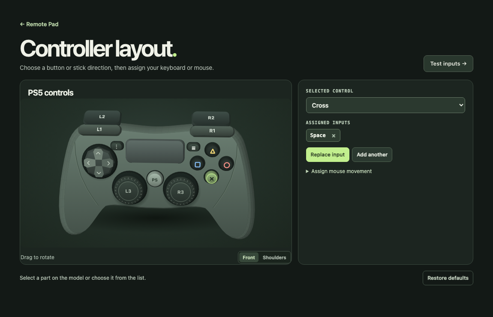

# Play your PS5 with Remote Pad

The Mac and Windows apps use **PS5 Web Play (ps5web)** to stream from a PS5 on your home network. Your keyboard and mouse act as the controller inside Remote Pad. The first setup requires access to the console's settings. Subsequent sessions use the saved pairing.

## Start the player on your computer

1. Install **Docker Desktop** for your computer and open it. Wait until its engine is running. On Windows select Linux containers. On Apple silicon the launcher runs the Intel Linux image using Docker's emulation. Check Docker's operating system requirements before installing. On Mac, update Safari to version 26 or newer for PS5 audio. [Docker for Mac](https://docs.docker.com/desktop/setup/install/mac-install/) · [Docker for Windows](https://docs.docker.com/desktop/setup/install/windows-install/) · [Safari audio support](https://webkit.org/blog/17333/webkit-features-in-safari-26-0/)
2. On the Remote Pad home screen, expand **PS5 setup** and choose **Start PS5 Player**. Docker downloads the pinned player on first use. Wait until the launcher shows a **local player password**. Run the launcher again whenever you need that password.
3. Return to Remote Pad and choose **Open PS5 Remote Play**. The local player opens in the app. Its interface is in Chinese. Choose **我要操控** (Take control) and enter the password from the launcher. The pairing form uses your PSN account ID. Keep your Sony account password on Sony's sign-in pages.

## Pair your console once

1. Connect the computer and PS5 to the same home network. On the PS5, enable **Settings → System → Remote Play → Enable Remote Play** for your user. Find the console's IPv4 address under **Settings → Network → Connection Status → View Connection Status**. [PlayStation Remote Play settings](https://www.playstation.com/en-us/support/games/remote-play-settings/)
2. Have your **base64 PSN Account-ID** ready. This is different from your online display name. If your public online ID is searchable, enter it in FlipScreen Games’ public lookup and copy the encoded ID. Alternatively, follow chiaki-ng’s PSN sign-in instructions. [Public account-ID lookup](https://psn.flipscreen.games/) · [chiaki-ng account instructions](https://chiaki-ng.github.io/chiaki-ng/setup/configuration/)
3. In the local player, enter the PS5's address under **手动添加** (manual add) and choose **添加** (Add). Using the address directly works with the launcher's Docker network even when automatic discovery cannot find the console.
4. On the PS5, select **Settings → System → Remote Play → Pair Device** (also called **Link Device**). In the player's pairing dialog enter the eight-digit number and your base64 account ID, then choose **开始配对** (Start pairing).
5. Choose **开始串流** (Start stream) for your paired console and confirm the stream options. When the control session opens, choose **Capture inputs**. Press **Esc** to release your keyboard and mouse.

## Controls and troubleshooting

With the default layout, WASD moves, the mouse looks around, right click holds L2, and left click holds R2. Move the mouse while holding either or both buttons. Space presses Cross, G presses PS, and T clicks the touchpad. Use the PS5 layout editor to change these assignments. The keyboard and mouse provide buttons and sticks. Games requiring physical motion controls, adaptive trigger feedback or specialized peripherals have additional requirements.

| What happens | What to check |
| --- | --- |
| Remote Pad cannot reach the player. | Start Docker Desktop, run **Start PS5 Player**, and wait for the password. Only one service can use the local port 17365. |
| The console does not appear, or pairing times out. | Type its current IPv4 address manually, use a fresh pairing code, and check the PS5 and computer are on the same network. Guest Wi-Fi can isolate devices. |
| Video plays without audio on a Mac. | Update Safari and macOS to a version supporting WebCodecs AudioDecoder. Check the speaker button in the player. |
| The picture opens but the capture button is missing. | Choose **我要操控** (Take control) and start the control session. The spectator view and sign-in forms keep the cursor free. |

Stop the session in the player when finished. In Docker Desktop, stop **remote-pad-ps5** to shut down the local service. Pairing data stays in the **remote-pad-ps5_pairing** volume. To forget your console, remove it in the player. To erase all companion settings, remove the stopped container and its pairing volume in Docker Desktop.

The launcher downloads ps5web 1.2.2 from its publisher and exposes it only on this computer at 127.0.0.1. PS5 Web Play and chiaki-ng are independent projects with their own licenses. [PS5 Web Play source](https://github.com/xiaobai9978/ps5web) · [Version used by Remote Pad](https://hub.docker.com/r/xiaobai9978/ps5web/tags?name=1.2.2) · [Remote Pad privacy](https://github.com/lamacchiasolutions/remote-pad/blob/main/PRIVACY.md)
